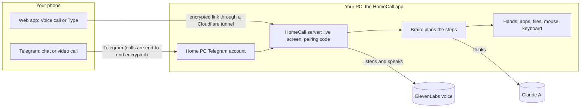

# HomeCall: call your home computer

**Away from home and need something from your PC? Call it.** HomeCall turns your computer into
something you can phone: you see its screen live, say what you want ("find my CV and send it
to me", "open Spotify"), and an AI on the PC does it and answers out loud. From the browser or
from Telegram, from anywhere.

- "What's on my desktop?" -> it looks and tells you.
- "Find my CV and send it to me." -> the file lands on your phone.
- "Open Discord, go to the Anthropic channel." -> you watch it happen on the live screen.
- "Delete the old draft." -> it asks **Yes / No** on your phone first.

## How it works



**One request, step by step** ("Find my CV and send it to me"):
1. Your voice goes to ElevenLabs, which turns it into text; the PC answers within seconds ("On it").
2. The **Brain** (Claude) gets your words plus a fresh screenshot and picks tools: *find file*, *send file to phone*.
3. The **Hands** run those tools on the PC. Anything risky (delete, send a message, risky clicks) first asks **Yes / No** on your phone.
4. The file arrives on your phone (a download card, or a message in Telegram) and the PC says what it did, out loud.

## Get it running (about 5 minutes)

1. **Download** this project: green **Code** button -> **Download ZIP** (or `git clone`). It needs Python 3.11+.
2. **Keys:** copy `.env.example` to `.env` and put in your Claude key (`ANTHROPIC_API_KEY`) and,
   for voice calls, an ElevenLabs key (`ELEVENLABS_API_KEY`). *Team members:* accept the invite to the
   private team-keys repo instead (https://github.com/Rokasxz/homecall-keys/invitations): the keys arrive by themselves.
3. **Double-click** `HomeCall.command` (Mac) or `HomeCall.bat` (Windows). The first time it installs what it
   needs (Python packages, the `cloudflared` tunnel) and, on a Mac, asks for **all** permissions at once
   (see the screen, control mouse and keyboard, open your folders): click Allow, then nothing pops up during a call.
4. The **PC window** opens with a QR code. **Scan it** with your phone's camera, then choose **Voice call** (talk,
   interrupt any time) or **Type**. Works from any network: the phone doesn't need the same Wi-Fi.

Showing it to people? Put `HOMECALL_DEMO=1` in `.env`: the AI then only sees demo files, never your real ones.
Demo-day checklist: [DEMO.md](DEMO.md).

## Call it from Telegram (optional)

Give the PC its own Telegram account ("Home PC"). Then, from your normal Telegram:
- **Write to it** ("What's on my desktop?", "Send me my CV"): it does it and answers in the chat. Files
  arrive in the chat, Yes/No questions come as a message, voice notes work.
- **Write "call"**: it calls you as a Telegram **video call** with its screen as the video, and you talk to
  the same AI. (Your phone may show the call as missed: tap the camera icon on the call message to join.)
- **Connect with a QR code:** the PC window shows a Telegram QR. Scan it with your phone: Telegram
  opens the Home PC chat with the PC's one-time code typed in, you tap **Send**, it answers
  "✅ Connected". From then on it answers you, also after restarts. Only connected accounts can use
  it (5 wrong codes = that account is ignored), one person at a time; **Remove** someone in the PC window.

Set it up once:
1. A Telegram account for the PC, on a spare SIM (not your own number).
2. https://my.telegram.org -> API development tools -> create an app; in `.env`:
   `TG_API_ID=...` and `TG_API_HASH=...`. (Optional: `TG_ALLOWED=@you,@friend` lets those accounts
   in without the QR.) Several people: it talks to one at a time, the others get "busy", and each
   person gets a fresh conversation.
3. Its own Python setup, then log the PC account in (type its phone number and the code):
   ```
   python -m venv .venv-tgcall
   .venv-tgcall/bin/pip install -r pc/telegram/requirements.txt
   .venv-tgcall/bin/python -m pc.telegram.home_pc --login
   ```
   (Windows: `.venv-tgcall\Scripts\pip` and `.venv-tgcall\Scripts\python`.)
4. Start HomeCall as usual: it starts the Telegram part too (`Telegram: on` in the summary).
5. In the PC window, scan the **Telegram QR** with your phone and tap **Send**: "✅ Connected".

Telegram calls need the PC on a network that lets them through: the venue Wi-Fi blocks them,
use the phone's hotspot. How it works: `pc/telegram/home_pc.py`.

## What it can do

| | |
|---|---|
| **Voice call** | Talk naturally, interrupt it; long tasks: "On it", then it tells you the result |
| **Type** | Same AI, text chat with the live screen |
| **Live screen** | See the PC while it works (browser or Telegram video) |
| **Files** | Find, read and send files to your phone (Desktop, Documents, Downloads, Pictures) |
| **Apps** | Open, switch, close apps; click, type, keys, media, volume, screenshots |
| **Safety** | Yes/No on the phone before deleting, sending or risky clicks |
| **Telegram** | Chat and video calls with your PC; several allowed people, one at a time |
| **Easy setup** | Double-click launcher, all permissions at the start, QR code pairing, demo mode |

## Safety and privacy (honest version)

- Only someone with the 6-digit code can connect (5 wrong codes = locked); one phone at a time.
  The PC window (with the code) only opens on the PC itself.
- Risky actions always ask Yes/No on the phone. Demo mode hides your real files.
- Everything travels encrypted; the Telegram video call is **end-to-end encrypted**. The web app goes
  through Cloudflare's tunnel (encrypted, but not end-to-end), and Telegram chats are not end-to-end.
- The AI runs in the cloud: Claude (thinking) and ElevenLabs (voice) process what it sees and hears.

## Limits today

- Some Wi-Fi (venues, schools) blocks the tunnel and Telegram calls: use a phone hotspot.
- The address and code change every start (QR code makes that painless).
- Telegram: the PC's calls show as "missed" on the phone (join from the chat); needs a spare SIM.
- On a slow upload the call video can lag behind.

## What's next

- **Accounts instead of codes:** log in on the PC app and on your phone, a fixed address, no QR needed.
- **End-to-end encryption for the web app:** even the tunnel can't see your screen.
- **"Nothing leaves your home" mode:** a local AI model and local voice.
- **Signed installers:** a real `.app` / `.exe`.

## Built with

Python (FastAPI, websockets, mss, pyautogui) on the PC, a plain HTML/JS phone app, Claude (Anthropic API
or Claude Code) as the Brain, ElevenLabs Conversational AI for voice, a Cloudflare tunnel to reach the PC,
Pyrogram + py-tgcalls for Telegram. Built in 2 days by a team of 5, each working with AI assistants.

---

## For the team and developers

- Plan, decisions and why: PLAN.md
- Team rules and the contract between the parts: CLAUDE.md
- Who does what: TASKS.md
- Teammates start here: TEAMMATE-GUIDE.md (login, rules, prompts, testing)
- How we work together: TEAM-SETUP.md, PROMPTS.md
- Every phone visit is written to `homecall.log` (private: never post it). Bugs: GitHub -> Issues -> New issue -> Bug.
- The team's Claude key costs a cent or two per request. No credits? `HOMECALL_BRAIN=max` in `.env`,
  `pip install claude-agent-sdk`, `claude auth login` (your own Claude subscription).
- Check the Mac permissions any time: `python -m pc.permissions`.

### Run it by hand (without the launcher)

Needs Python 3.11 or newer.

```
python -m venv .venv
```
Mac/Linux: `source .venv/bin/activate`   Windows: `.venv\Scripts\activate`
```
pip install -r requirements.txt
python check.py
python -m pc.server
```

`check.py` tests your setup and tells you what to fix. The server prints a 6-digit pairing code. On the same computer, open
http://localhost:8000, enter the code, and you're "on the call".

#### Let the AI think
Create a file named `.env` in the project root with one line:
```
ANTHROPIC_API_KEY=sk-ant-...
```
Without it the app runs in "echo mode": everything works except the thinking.

**No API credits?** On a computer where Claude Code is installed and logged in
(e.g. with a Claude Max plan), put `HOMECALL_BRAIN=max` in `.env` and run
`pip install claude-agent-sdk`. The Brain then thinks through Claude Code's login.
Start the server from a normal Terminal window. If replies say "Failed to
authenticate", run `claude auth login` once in Terminal.

#### From the phone (and from anywhere)
The phone's microphone only works on https pages, so we use a free tunnel that
gives the PC an https address. Install `cloudflared` once
(Mac: `brew install cloudflared`, Windows: `winget install Cloudflare.cloudflared`),
then in a second terminal:
```
cloudflared tunnel --url http://localhost:8000
```
It prints an address like `https://something.trycloudflare.com`. Open that on the
phone. The address changes every time you restart cloudflared.

If cloudflared keeps logging QUIC timeouts or "Allow outbound TCP on port 7844",
the network (e.g. venue or school Wi-Fi) blocks the tunnel. Connect the PC to a
phone hotspot instead. (`--protocol http2` doesn't help: it also needs port 7844.)

The server only listens on this PC (`127.0.0.1`), so phones always come in
through the tunnel, never straight over the Wi-Fi. For a quick test at home
without the tunnel, put `HOMECALL_HOST=0.0.0.0` in `.env` and open
`http://<the PC's IP>:8000` on a phone on the same Wi-Fi (no microphone: that
needs https). Never do that at the venue.

Pairing rules: after 5 wrong codes in a row nobody can pair for 60 seconds;
only one phone can be on the call at a time; files sent to the phone stop
downloading when the call ends.

#### Mac only
The first time, macOS asks for Screen Recording and Accessibility permission
for your terminal (System Settings -> Privacy & Security). Without them the
live view is a grey placeholder and typing/clicking does nothing.

### Folders
```
start.py         one command: server + tunnel + voice agent + Telegram (Lead)
HomeCall.command / HomeCall.bat   double-click launchers (Lead)
pc/server.py     the server: phone page, screen stream, messages   (Server & connection)
pc/screen.py     screenshots                                         (Server & connection)
pc/session.py    one call; talk back to the phone from anywhere      (Server & connection)
pc/actions/      what the AI can DO on the PC: the tools             (Hands)
pc/brain/        the AI loop: words -> tool calls -> spoken reply     (Brain)
pc/voice/        speech-to-text and text-to-speech on the PC          (Voice)
phone/           the phone web app: live view, mic, speech           (Phone app)
pc/telegram/     the PC's own Telegram account: chat + video calls   (Lead)
pc/permissions.py  Mac permissions, all asked at the start           (Server)
tests/, demo/    tests, demo files, pitch                            (Demo, tests & safety)
```
